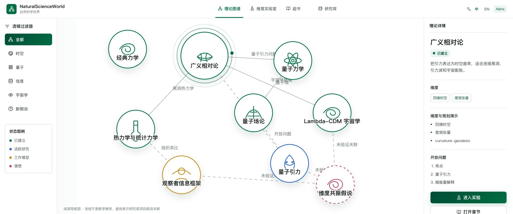
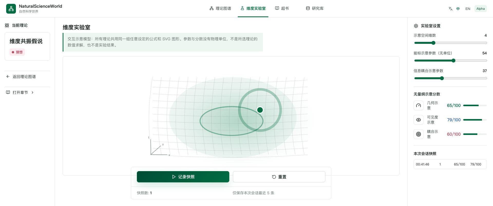
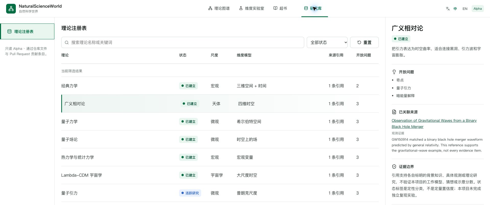
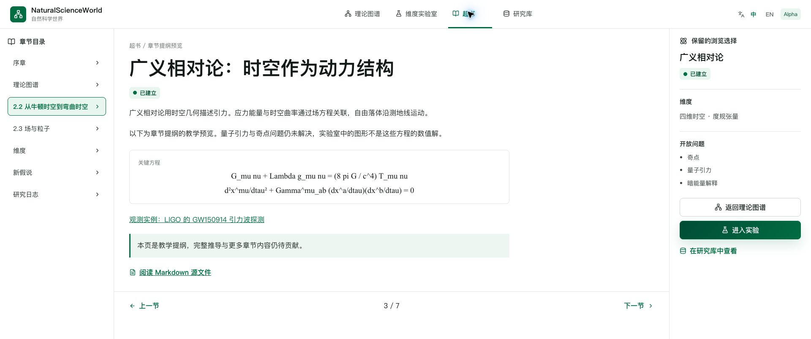
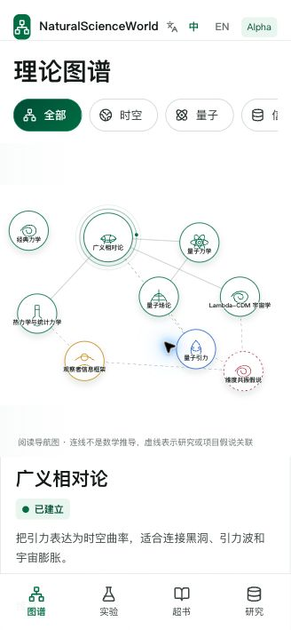

# NaturalScienceWorld · 自然科学世界

**把科学理论连成一本能阅读、能操作、能追溯来源的超书。**

[English](README.md) · [本地运行](#本地运行) · [参与贡献](CONTRIBUTING.md) · [科学边界](#科学边界) · [MIT 许可证](LICENSE)

NaturalScienceWorld 是一个中英双语的早期探索项目。你可以从理论图谱进入解释页面，调节演示参数，再到研究库查看理论状态和开放问题。文字、交互和结构化资料共同构成这本持续生长的“超书”。

**Alpha · `v0.1.0-alpha.1`**：当前版本用于学习与探索。维度演示采用项目自定义公式，不是物理求解器，也不是实验验证。项目内的新假说始终标记为未验证。



## 一分钟体验

1. **在图谱中找理论。** 按时空、量子、信息、宇宙学或假说过滤；选择节点，查看简介和科学状态。
2. **动手调节演示。** 进入维度实验室，观察参数变化带来的图形与分数变化。这些分数是界面模型的示意量，不是测量值。
3. **阅读与比较。** 浏览章节预览，在研究库中按关键词和科学状态查找条目，再查看来源链接及其支持范围。
4. **查看可复现的源文件。** 阅读 Markdown 和 JSON，或运行确定性的命令行覆盖度示例。

界面支持中文、英文和移动端布局。本地运行不需要 API Key，当前实验室不会调用远程模型服务。

| 维度实验室 · 示意性玩具模型 | 研究库 · 可追溯的来源 |
| --- | --- |
|  |  |

<details>
<summary>查看章节预览与移动端界面</summary>





</details>

## 本地运行

安装 Node.js 22 或更新版本和 npm 后执行：

```bash
git clone https://github.com/eust-w/NaturalScienceWorld.git
cd NaturalScienceWorld
npm ci
npm run dev
```

打开 Vite 输出的本地地址，通常是 `http://127.0.0.1:5173`。

| 命令 | 用途 |
| --- | --- |
| `npm run check` | 测试、注册表校验、TypeScript 类型检查和构建 |
| `npm run validate:registry` | 校验注册表必填字段及状态值 |
| `npm run demo:dimensions` | 输出确定性的注册表覆盖度玩具评分 |
| `npm run build` | 将静态应用构建到 `theory-lab/dist/` |
| `npm run preview` | 本地预览构建结果 |

注册表校验只检查数据结构，不验证科学结论。包中的 `private` 用于防止意外发布到 npm；仓库采用 MIT 许可证。

## 三条轨道，一个项目

| 轨道 | 当前内容 | 欢迎贡献 |
| --- | --- | --- |
| [超书 Hyperbook](hyperbook/) | Markdown 章节草稿、参考文献和假说模板 | 解释、引用、翻译 |
| [理论实验室 Theory Lab](theory-lab/) | 理论图谱、参数化玩具演示、章节预览和可搜索理论卡片 | 无障碍交互、可解释演示 |
| [研究库 Research Hub](research-hub/) | 十个理论条目、代表性来源链接和确定性的命令行示例 | 来源元数据、可复现性、适用边界 |

当前网页展示九张理论卡片，JSON 注册表包含十个条目。网页已通过明确的 ID 映射读取注册表中的引用；双语摘要及其他展示元数据仍独立维护。条目中的 `demo_hooks` 是演示规划，不表示对应模拟器已经完成。

## 科学边界

| 状态 | 含义 |
| --- | --- |
| `established` · 已建立理论 | 在适用范围内具有较强经验证据支持 |
| `active-research` · 活跃研究 | 仍有关键问题未解决的研究领域 |
| `working-model` · 工作模型 | 本项目用于组织或解释内容的模型 |
| `speculative` · 推测假说 | 尚未验证，需要形式化、约束和检验的假说或类比 |

“观察者信息框架”是项目内部的组织模型；“维度共振”是假说种子，目前没有确认性证据。图谱连线是策划整理的导航关系，不是严格的推导关系。章节仍是预览与草稿，不是完成的教科书或经过独立评审的研究成果。

注册表中八个条目各有一条代表性来源链接，其中七个显示在网页中；两个项目自拟条目没有支持来源。引用区分教学背景、理论背景和观测证据，并说明支持范围。这是起步阶段的文献整理，不是完整证据审查或独立复现实验。

请参阅[科学贡献规范](CONTRIBUTING.md#scientific-contributions)和[参考文献](hyperbook/references/references.bib)。

## 一起完成下一版

- 扩充理论条目的来源，明确每条引用具体支持哪个命题。
- 实现一个小型演示，例如振子、相空间轨道或二态系统，附上已知极限和检验方法。
- 在已有引用映射的基础上，统一双语摘要与其他重复元数据。
- 改进键盘操作、屏幕阅读器描述和移动端阅读。
- 将 Markdown 正文、引用与可复现示例接入章节阅读器。

从[贡献指南](CONTRIBUTING.md)中的小任务开始。修正解释和证据边界，同样是有价值的贡献。

## 许可证与致谢

项目代码和原创文档采用 [MIT 许可证](LICENSE)。依赖保留各自许可证，详见[第三方声明](THIRD_PARTY_NOTICES.md)。科学文献归其作者所有，本项目引用文献，不重新授权文献原文。

[首发说明](docs/launch/README.md) · [安全报告](SECURITY.md) · [社区行为规范](CODE_OF_CONDUCT.md)
